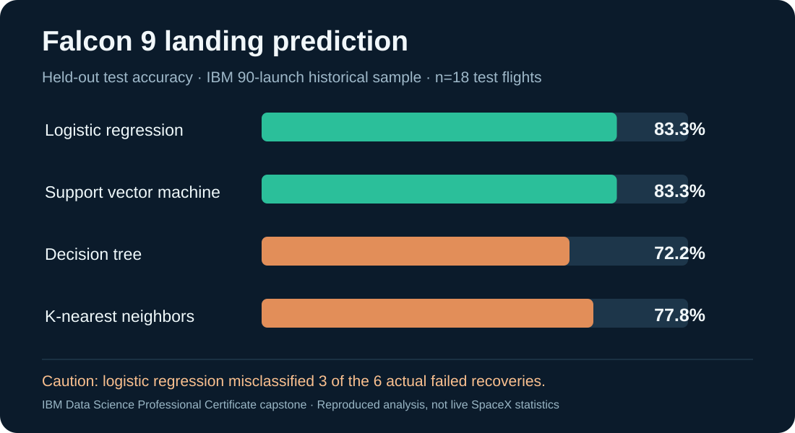

# Falcon 9 First-Stage Landing Prediction

**An end-to-end data science case study | IBM Applied Data Science Capstone**

Can historical launch data help distinguish successful from unsuccessful Falcon 9 first-stage recoveries? This repository documents the process—from acquiring historical data to exploring launch conditions, building an interactive dashboard, and evaluating supervised classification models.



> **Scope:** This is an educational analysis based on historical IBM SkillsNetwork course datasets. It is not a live SpaceX prediction service or an operational risk model.

## Key findings

| Metric | Reproduced historical result |
|---|---|
| EDA and modeling dataset | 90 launch records |
| Successful first-stage recoveries | 60 / 90 (66.7%) |
| Top held-out accuracy | 83.3% (15 / 18) — Logistic Regression and SVM |
| Important limitation | Logistic Regression predicted success for 3 of 6 actual failures |

The 18-flight test sample is small. Accuracy should not be taken as a reliable estimate of performance on future launches. See [full results and caveats](analysis/RESULTS.md).

## Project workflow

| Stage | What is demonstrated | Tools |
|---|---|---|
| Data collection | SpaceX API requests and historical Wikipedia table extraction | Requests, BeautifulSoup |
| Cleaning & exploration | Feature preparation, trends, launch-site and orbit comparisons | Pandas, NumPy, Matplotlib, Seaborn |
| Database analysis | Historical launch questions and aggregation | SQL, SQLite |
| Mapping & dashboard | Launch-site exploration and interactive outcome charts | Folium, Plotly Dash |
| Prediction | Train/test evaluation of Logistic Regression, SVM, Decision Tree, and KNN | Scikit-learn |

## Start here

- **[Project case study](docs/CASE_STUDY.md)** — problem, approach, outcomes, and limitations
- **[Results and data provenance](analysis/RESULTS.md)** — evaluation details, dataset definitions, and numerical evidence
- **[Interactive dashboard](dashboard/)** — runnable application and its historical dashboard dataset
- **[Model reproduction script](analysis/reproduce_results.py)** — executable four-model comparison
- **[Original IBM lab notebooks](notebooks/)** — six preserved exercises organized by workflow
- **[SQL analysis queries](analysis/spacex_sql_queries.sql)** — the ten SQLite lab queries

## Repository structure

```text
.
├── README.md
├── requirements.txt
├── analysis/
│   ├── RESULTS.md
│   ├── reproduce_results.py
│   └── spacex_sql_queries.sql
├── assets/
│   └── model_comparison.svg
├── dashboard/
│   ├── README.md
│   ├── app.py
│   └── spacex_launch_dash.csv
├── docs/
│   ├── CASE_STUDY.md
│   └── portfolio/
│       └── linkedin-copy.md
└── notebooks/
    ├── README.md
    ├── 01_api_data_collection.ipynb
    ├── 02_wikipedia_web_scraping.ipynb
    ├── 03_exploratory_data_analysis.ipynb
    ├── 04_sql_exploration.ipynb
    ├── 05_launch_site_mapping.ipynb
    └── 06_machine_learning_classification.ipynb
```

## Run the project

Requires Python 3.10+ and internet access for the reanalysis script.

```bash
git clone https://github.com/aelshamlool0720-stack/IBM-SpaceX-Capstone.git
cd IBM-SpaceX-Capstone
python -m venv .venv
source .venv/bin/activate
python -m pip install -r requirements.txt

# Reproduce the four-model comparison
python analysis/reproduce_results.py

# Start the local interactive dashboard (requires no further data download)
python dashboard/app.py
```

On Windows PowerShell, activate your environment with `.venv\Scripts\Activate.ps1`. Dash prints a local URL, usually `http://127.0.0.1:8050`; the app is **not deployed** online.

For the course notebooks, run `jupyter lab` and open a file under [`notebooks/`](notebooks/). Some older labs use notebook-specific installation commands, downloads, or IPython SQL extensions. The **separate** reanalysis script is the straightforward way to reproduce the comparison above.

## Data provenance and limitations

IBM provided different historical datasets for different exercises: **90 records** for EDA/modeling, **56** for the dashboard, and **101** for SQL. The samples are not interchangeable, and the published figures do not describe today's launches. Site and orbit patterns are descriptive rather than causal; a randomly held-out historical sample does not establish prospective predictive reliability.

The six notebooks are **IBM course-based exercises, preserved and clearly labeled as such**. The supplementary script, analysis documentation, project presentation and repository structure provide additional reproducible organization and evaluation; none of this represents a production-grade SpaceX application.

## Attribution

Created as part of the **IBM Data Science Professional Certificate — Applied Data Science Capstone**. Original course material and historical datasets are credited to IBM SkillsNetwork, with underlying public information from the SpaceX API and Wikipedia. No affiliation with or endorsement by SpaceX is implied.
